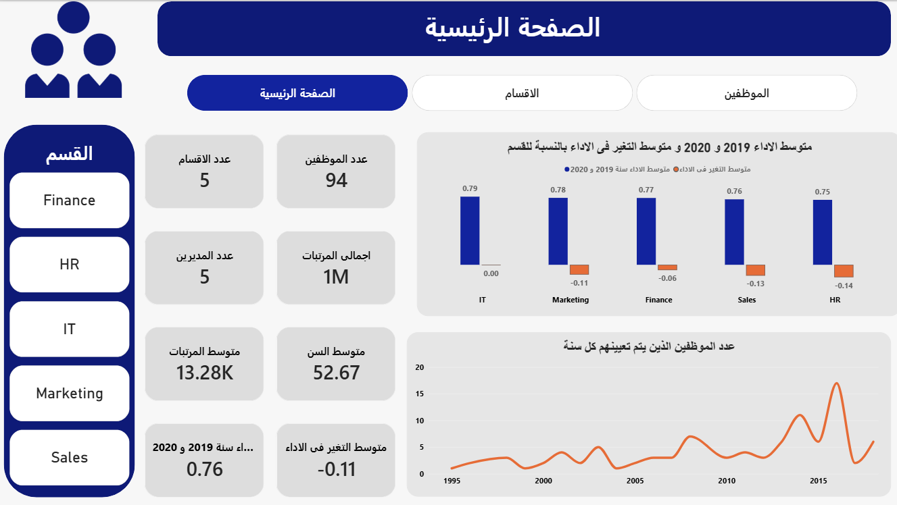
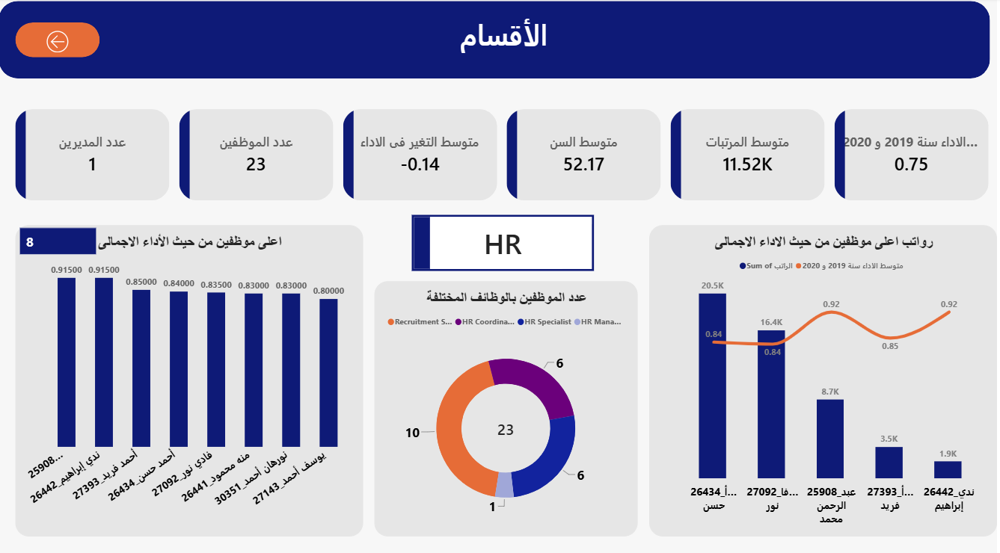
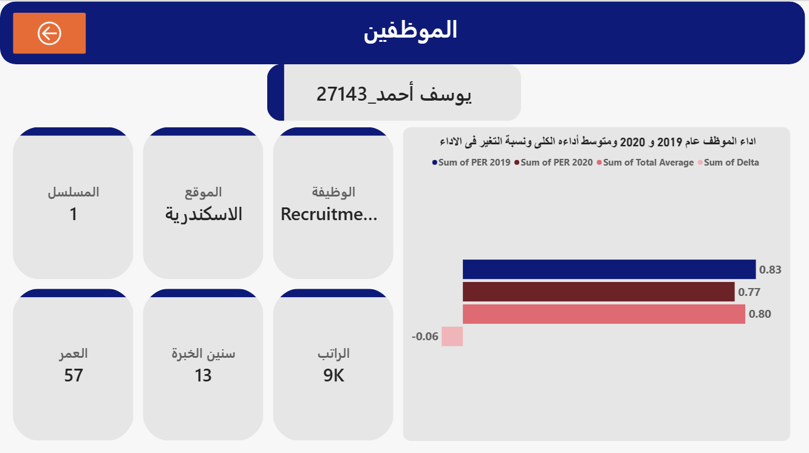

# HR Performance Dashboard

An interactive **Power BI** dashboard that analyzes employee performance (2019–2020), salaries, age and experience across departments. It features drill-through navigation from company level to department level to individual employee, and a **dynamic Top N ranking** driven by a numeric parameter and `RANKX`.

> The interface is in Arabic (RTL).

---

## Table of Contents
- [Overview](#overview)
- [Key Features](#key-features)
- [Dashboard Pages](#dashboard-pages)
- [Screenshots](#screenshots)
- [Data Model](#data-model)
- [Dynamic Top N Ranking](#dynamic-top-n-ranking)
- [Handling Duplicate Names](#handling-duplicate-names)
- [Key Measures](#key-measures)
- [Tech Stack](#tech-stack)
- [Getting Started](#getting-started)
- [Repository Structure](#repository-structure)
- [Data Privacy](#data-privacy)
- [Author](#author)

---

## Overview

The dashboard helps HR and management answer questions such as:

- How does performance change between 2019 and 2020 in each department?
- Who are the top-performing employees in a given department?
- How do salaries, age and years of experience compare across departments?
- How has hiring changed over the years?

| Metric | Value |
|---|---|
| Employees | 94 |
| Departments | 5 (Finance, HR, IT, Marketing, Sales) |
| Managers | 5 |
| Period analyzed | 2019 – 2020 |

---

## Key Features

- **Three-level drill-through:** Home → Department → Employee
- **Dynamic Top N ranking** using a numeric range parameter and `RANKX`
- **Department slicer** for quick filtering on the home page
- **KPI cards:** headcount, departments, managers, total and average salary, average age, average performance, average performance change
- **Unique employee labels** (Name + ID) to handle employees who share the same name
- **Time analysis** of hiring by year using a dedicated Date table

---

## Dashboard Pages

### 1. Home
Company-wide overview.
- KPI cards for headcount, departments, managers, salaries, age, performance and performance change
- Clustered chart: average performance 2019 & 2020 and average performance change by department
- Line chart: number of employees hired per year
- Department selector

### 2. Departments (drill-through)
Opened by drilling through from a department.
- Department-specific KPIs
- Top N employees by overall performance (N controlled by the Rank slicer)
- Top employees by salary compared with their performance
- Job distribution donut chart

### 3. Employees (drill-through)
Opened by drilling through from an employee.
- Employee profile: job title, location, serial number, age, years of experience, salary
- Performance chart: 2019, 2020, total average and delta

---

## Screenshots

| Home | Departments |
|---|---|
|  |  |

| Employees | Data Model |
|---|---|
|  |  |

---

## Data Model

| Table | Type | Description |
|---|---|---|
| `Dep Employees` | Fact | One row per employee: performance, salary, age, experience, job, location, hire date |
| `Dep managers` | Dimension | Department managers |
| `Date` | Dimension | Calendar table (Dates, Month, Month Name, Quarter, Year) |
| `Rank` | Parameter | Numeric range parameter for Top N |
| `_Measure` | Measures | Container table for all DAX measures |

**Relationships**
- `Dep managers` ↔ `Dep Employees`: one-to-one
- `Date` → `Dep Employees`: one-to-many (active on hire date, inactive on the second date column)

---

## Dynamic Top N Ranking

The user selects **N** with a slicer, and the chart shows only the top N employees. The ranking recalculates automatically for the department selected through drill-through.

---

## Handling Duplicate Names

Several employees share the same name (for example, three different employees named "أحمد حسن") but have different IDs. Grouping or ranking by name merges them into one row and breaks the rank.

---

## Key Measures

| Measure | Description |
|---|---|
| عدد الموظفين | Number of employees |
| عدد الاقسام | Number of departments |
| عدد المديرين | Number of managers |
| اجمالى المرتبات | Total salaries |
| متوسط المرتبات | Average salary |
| متوسط السن | Average age |
| متوسط سنين الخبرة | Average years of experience |
| متوسط الاداء سنة 2019 و 2020 | Average performance across 2019 and 2020 |
| متوسط التغير فى الاداء | Average performance change (delta) |
| Dynamic Avg Rank | Dynamic Top N performance ranking |

---

## Tech Stack

- **Power BI Desktop**
- **DAX:** `RANKX`, `ISINSCOPE`, `ALLSELECTED`, `SELECTEDVALUE`, `CALCULATE`
- **Power Query (M)** for data cleaning and shaping
---

## Data Privacy

The data in this repository is **anonymized / sample data**. Names, IDs and salaries do not correspond to real people. Do not commit real employee data to a public repository.

---
